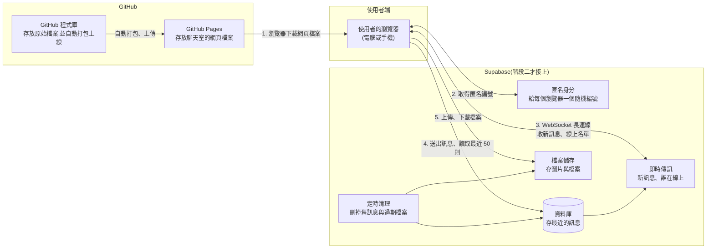
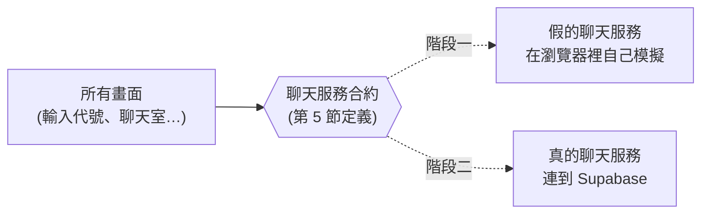
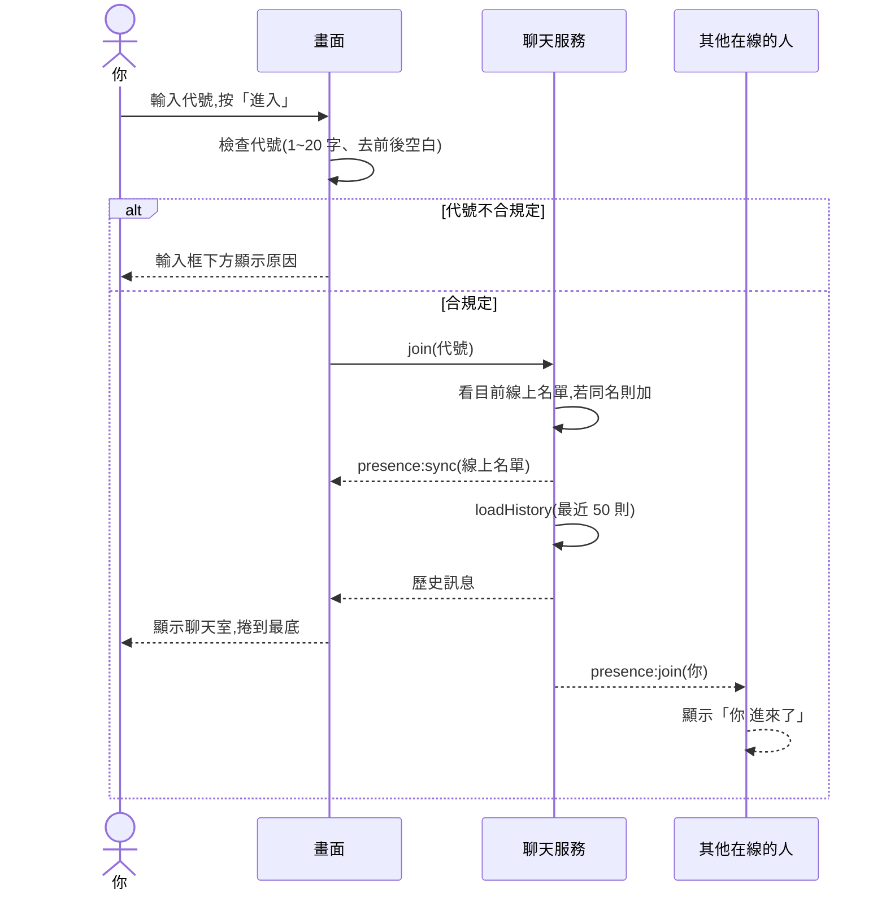
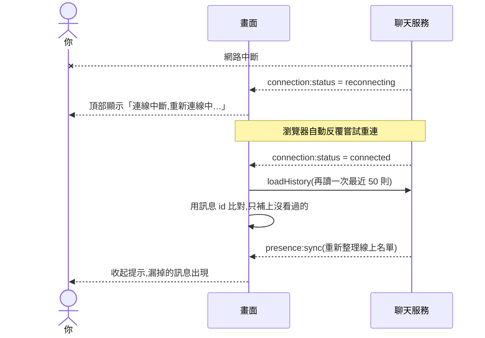

# 匿名聊天室 架構文件

> 這份文件是寫給「不寫程式的人」看的。每個專有名詞第一次出現時,會用一句話解釋。
> 文件裡不包含任何程式碼,畫面的顏色與樣式由 `/design` 決定,不在這裡規定。

---

## 1. 專案說明與目標

### 這是什麼
一個**不用註冊、不用登入**的匿名聊天室。任何知道網站連結的人,用電腦或手機打開網頁、輸入一個代號,就能進到同一個聊天室,看到大家的訊息,也能送出自己的訊息。

### 使用者能做的事(都是你在訪談中確認過的)
- 輸入代號進入聊天室。代號重複時,系統自動在後面加編號(例如「小明#2」)。
- 看到最近 50 則訊息,之後即時收到新訊息。
- 送出文字(最多 500 字),也可以附上一張圖片或一個檔案(最大 5 MB)。
- 看到誰在線上,以及有人進來、離開的提示。
- 網路斷掉時看到提示,連回來後自動補上漏掉的訊息。
- 按「離開」回到輸入代號的畫面。

### 目標
1. 第一步:先做出完整的畫面,放到 GitHub Pages 上,任何人打開網址就能看到、操作(此時還不是真的聊天)。
2. 第二步:接上 Supabase,讓它變成真的、多人可以同時使用的聊天室。
3. 第二步完成時,**畫面不需要重做**,只是把「假資料」換成「真資料」。

### 名詞小辭典(第一次出現的地方也會再解釋)
| 名詞 | 一句話解釋 |
|------|-----------|
| **GitHub Pages** | GitHub 提供的免費網頁放置服務,只能放「寫好就固定不變的網頁檔案」,不能執行伺服器程式 |
| **Supabase** | 一個現成的線上服務,提供資料庫、即時傳訊、檔案儲存等功能,讓我們不用自己架伺服器 |
| **WebSocket** | 瀏覽器和伺服器之間保持不斷線的連線,所以有新訊息時伺服器可以立刻推給你,不用你一直重新整理 |
| **前端** | 使用者在瀏覽器裡看到和操作的部分 |
| **後端** | 在遠端幫忙存資料、傳資料的部分。這個專案的後端就是 Supabase |

---

## 2. 整體架構圖



### 怎麼看這張圖
- **GitHub Pages 只負責「把網頁交給瀏覽器」**。網頁下載完之後,聊天的所有事都由瀏覽器直接和 Supabase 溝通,不會再經過 GitHub。
- **沒有任何我們自己管理的伺服器**。這是刻意的:你不需要維護、不需要付伺服器費用。
- 階段一時,圖中的 Supabase 整塊都還沒有接上,瀏覽器只和 GitHub Pages 有關係。

---

## 3. 技術選擇

每一項都寫「選了什麼」和「為什麼」。

### 3.1 前端程式語言與框架

| 項目 | 選了什麼 | 為什麼 |
|------|---------|--------|
| 語言 | **TypeScript** | 它是 JavaScript(網頁唯一通用的程式語言)加上「資料格式檢查」。聊天室裡訊息、使用者、事件都有固定格式,事先檢查可以在出錯之前就發現問題,特別是第二階段把假資料換成真資料時。 |
| 框架 | **React** | 框架就是現成的「蓋網頁的工具組」。聊天室的畫面會一直跟著資料變(新訊息進來、有人上線),React 擅長「資料變了,畫面自動跟著更新」。另外 `/frontend-design` 也最常產出 React 的畫面元件。 |
| 打包工具 | **Vite** | 把我們寫的檔案整理成瀏覽器能直接用的網頁檔案(稱為「打包」)。它輸出的是純靜態檔案,正好符合 GitHub Pages 的限制。設定也很少。 |
| 樣式 | **一般的 CSS** | 不引入額外的樣式套件。深色與淺色會自動跟著使用者的裝置設定。具體的顏色和外觀由 `/design` 決定。 |

**為什麼不用 Next.js 之類的框架?** 它們需要一台會執行程式的伺服器,而 GitHub Pages 只能放靜態檔案,所以不適用。

### 3.2 Supabase 用哪些功能

| 需求 | 選了什麼 | 為什麼 |
|------|---------|--------|
| 新訊息即時出現在所有人的畫面 | **Realtime 的「資料庫變動通知」** | 每則訊息都先存進資料庫,資料庫一有新增,就自動通知所有在線的人。這樣「看到的訊息」和「存起來的訊息」不會不一致,而且斷線後可以從資料庫補回漏掉的內容。 |
| 誰在線上、進入與離開 | **Realtime 的「線上狀態」(Presence)** | 這個功能就是為「線上名單」設計的。瀏覽器關閉或斷線時,伺服器會自動把這個人標為離開,我們不用自己偵測。 |
| 新進者看到最近 50 則 | **資料庫查詢** | 從資料庫取出最新的 50 筆。 |
| 圖片與檔案 | **Storage(檔案儲存)** | 檔案不適合塞進資料庫。這個功能內建大小上限與存取規則。 |
| 不登入,但仍能分辨是不是同一個人 | **匿名身分(Anonymous sign-in)** | 見下一段。 |
| 定時清理 | **排程工作(pg_cron)** | Supabase 內建的定時器,可以每小時自動執行清理。 |

**為什麼不用 Realtime 的「廣播」功能傳訊息?** 廣播只是「喊一聲就算了」,不會存起來。晚進來的人看不到歷史,斷線的人也補不回漏掉的訊息,與你要的功能不符。

#### 關於「匿名身分」(這是我替你做的決定,請特別留意)
使用者不會看到任何登入畫面或註冊步驟。但網頁在背景會向 Supabase 要一個**隨機的編號**(像一張沒有名字的號碼牌)。這個編號有三個用途:

1. **防洗版**:資料庫要知道「這則訊息是同一個人送的」,才能限制每 3 秒一則。如果只靠網頁上的限制,有人用瀏覽器的開發者工具就能繞過。
2. **防偽造**:規則可以寫成「你只能用自己的編號送訊息」,不能冒充別人。
3. **記住你**:重新整理網頁後,編號還在,所以能自動回到聊天室。

這個編號只存在使用者的瀏覽器裡,不含任何個人資料。清除網站資料或換瀏覽器,就是另一個全新的匿名者。

---

## 4. 兩個階段

### 設計原則:讓網頁只認識一個「聊天服務」窗口
前端有一份「聊天服務」的**合約**(程式界稱為「介面」):它規定畫面可以向聊天服務要求哪些事,以及聊天服務會通知畫面哪些事。**所有畫面只和這份合約說話,完全不知道背後是假資料還是 Supabase**。



階段二只需要新增「真的聊天服務」,再把畫面使用的服務從「假的」換成「真的」。**畫面本身不用動**。這就是「不用整個重寫」的做法。

### 階段一:還沒接 Supabase

#### 前端要能做到什麼程度
**全部的畫面和操作都要做完且可以操作**,只是資料是模擬的。包括:

| 功能 | 階段一怎麼呈現 |
|------|---------------|
| 輸入代號與檢查 | 完整可用(長度、空白等規則真的會檢查) |
| 代號重複自動加編號 | 完整可用(模擬名單中預設有幾位假使用者,可以故意輸入同名測試) |
| 看到歷史訊息 | 一開始就有約 50 則預先寫好的假訊息 |
| 送出文字訊息 | 完整可用,送出後立刻出現在自己的畫面 |
| 別人的訊息 | 由幾位**機器人使用者**每隔幾秒自動發言,讓畫面看起來有人在聊 |
| 線上名單與進出提示 | 機器人會隨機上線、離開,畫面真的會出現提示 |
| 送出圖片與檔案 | 選檔、大小與類型檢查、顯示圖片、下載檔案都可用。檔案只暫存在這個瀏覽器分頁裡,關掉就消失 |
| 檔案過期顯示 | 預先放幾則「已過期」的假訊息,可以看到「檔案已過期」的樣子 |
| 防洗版倒數 | 完整可用(3 秒鎖定與提示) |
| 斷線提示 | 提供一個**只在階段一存在的隱藏測試開關**,可以模擬「斷線」與「連回」,看提示和補訊息的效果 |
| 離開、重新整理後自動回來 | 完整可用(代號記在瀏覽器裡) |
| 手機與電腦版面 | 完整可用 |
| 兩個分頁互相聊天 | 在同一個瀏覽器開兩個分頁,可以彼此看到對方的訊息(用瀏覽器內建的分頁互通功能模擬),方便你自己測試 |

#### 階段一的限制(請知道)
- 沒有真正的「多人」:不同人的手機和電腦之間**看不到彼此**。
- 重新整理後,你自己送過的訊息會消失(因為沒有存到任何地方)。

#### 怎麼在 GitHub Pages 上看到
1. 把專案放到 GitHub。
2. 設定好自動上線(見第 12 節),每次更新主要分支,GitHub 會自動打包並更新網站。
3. 打開 `https://<你的帳號>.github.io/<專案名稱>/` 即可看到。

### 階段二:接上 Supabase 之後的改變

| 項目 | 階段一 | 階段二 |
|------|--------|--------|
| 聊天服務 | 假的(瀏覽器內模擬) | 真的(連到 Supabase) |
| 訊息 | 機器人與預設內容 | 真人送出,存進資料庫 |
| 歷史 | 預先寫好的假訊息 | 資料庫裡最近 50 則 |
| 線上名單 | 機器人 | 真人(Supabase 線上狀態) |
| 檔案 | 暫存在分頁裡 | 存到 Supabase 檔案儲存,24 小時後自動刪除 |
| 防洗版 | 只在畫面上限制 | 畫面限制,**加上資料庫端真正把關** |
| 安全規則 | 無 | 有(第 9 節) |
| 測試用的隱藏開關(模擬斷線、機器人) | 有 | 不載入 |
| 畫面 | 不變 | **不變** |

階段二新增的工作:
1. 建立 Supabase 專案並開啟「匿名身分」。
2. 建立資料表、安全規則、檔案儲存空間、定時清理(這些都寫成設定檔放進 repo,方便重做與檢查)。
3. 寫「真的聊天服務」,換掉「假的」。
4. 把 Supabase 的網址與公開金鑰設定到 GitHub,重新上線。

---

## 5. 通訊約定:事件名稱與訊息資料格式

「事件」就是「系統裡發生了一件事,通知對方」。這一節是前面所說的**聊天服務合約**的具體內容。階段一的假服務與階段二的真服務都必須照這份合約運作。

### 5.1 畫面可以對聊天服務「提出的要求」

| 要求名稱 | 做什麼 | 需要提供 | 可能失敗的原因 |
|---------|--------|---------|---------------|
| `join`(進入) | 以某個代號進入聊天室 | 代號 | 代號不合規定 |
| `leave`(離開) | 離開聊天室 | 無 | 無 |
| `sendMessage`(送訊息) | 送出一則訊息 | 文字,以及可選的一個檔案 | 空訊息、太長、太快、檔案太大或類型不被允許 |
| `loadHistory`(讀歷史) | 取得最近 50 則訊息 | 無 | 連線失敗 |

### 5.2 聊天服務會「通知畫面的事件」

| 事件名稱 | 什麼時候發生 | 附帶的內容 |
|---------|-------------|-----------|
| `message:new` | 有新訊息(包含自己的) | 一則「訊息」(格式見 5.3) |
| `presence:sync` | 線上名單整份更新(剛進入時、重新連線後) | 「線上使用者」清單 |
| `presence:join` | 有人進來 | 一位「線上使用者」 |
| `presence:leave` | 有人離開 | 一位「線上使用者」,加上 `graceful`(是否為對方主動按「離開」)。主動離開立刻提示;否則畫面延遲約 5 秒再提示 |
| `connection:status` | 連線狀態改變 | `connecting`(連線中)、`connected`(已連線)、`reconnecting`(重新連線中) 其中一個 |

### 5.3 資料格式

#### 訊息(Message)
| 欄位 | 意思 | 是否一定有 | 說明 |
|------|------|-----------|------|
| `id` | 訊息的唯一編號 | 是 | 用來避免同一則訊息被重複顯示 |
| `userId` | 發送者的匿名編號 | 是 | 畫面用它判斷這則是不是「自己」送的(決定靠右或靠左) |
| `nickname` | 發送當下的代號 | 是 | 含自動加的 `#2`,送出後就固定,不會再變 |
| `body` | 文字內容 | 否 | 最多 500 字 |
| `file` | 附件 | 否 | 格式見下 |
| `createdAt` | 送出時間 | 是 | **以伺服器時間為準**,不信任使用者的手機時間 |

規則:`body` 和 `file` **至少要有一個**。

#### 附件(File)
| 欄位 | 意思 |
|------|------|
| `url` | 檔案的網址(用來顯示圖片或下載) |
| `name` | 原始檔名,例如「報告.pdf」 |
| `type` | 檔案類型,畫面據此決定「直接顯示圖片」或「顯示成下載連結」 |
| `size` | 檔案大小 |

#### 線上使用者(PresenceUser)
| 欄位 | 意思 |
|------|------|
| `userId` | 匿名編號 |
| `nickname` | 目前顯示的代號(含 `#2`) |
| `joinedAt` | 進入時間 |

#### 錯誤(ChatError)
每個失敗都回傳一個**代碼**加一句**給使用者看的中文說明**,畫面直接顯示說明即可:

| 代碼 | 情況 | 給使用者看的訊息(範例) |
|------|------|----------------------|
| `NICKNAME_INVALID` | 代號為空或超過 20 字 | 「代號需為 1 到 20 個字」 |
| `MESSAGE_EMPTY` | 沒有文字也沒有檔案 | 「請輸入內容」 |
| `MESSAGE_TOO_LONG` | 超過 500 字 | 「訊息最多 500 字」 |
| `RATE_LIMITED` | 送太快 | 「請稍等一下」 |
| `FILE_TOO_LARGE` | 超過 5 MB | 「檔案太大,上限 5 MB」 |
| `FILE_TYPE_BLOCKED` | 不被允許的檔案類型 | 「不支援這種檔案」 |
| `NETWORK` | 網路或伺服器問題 | 「連線有問題,請稍後再試」 |

---

## 6. 資料流

以下每一段都是「使用者做了什麼 → 系統內部依序發生什麼」。

### 6.1 進入聊天室



補充:瀏覽器會把你最後使用的代號記起來。下次打開網頁(或按重新整理),如果記著代號就**直接進入聊天室**,不用重新輸入。

### 6.2 送出訊息

1. 你輸入文字,或選擇一個檔案。
2. **選檔當下**,畫面就先檢查大小與類型。不合規定立刻顯示原因,不會開始上傳。
3. 你按送出(電腦可按 Enter)。畫面檢查:不是空的、不超過 500 字、距離上一則已過 3 秒。
4. 畫面鎖住輸入框 3 秒,並顯示「請稍等一下」倒數。
5. 如果有檔案,先上傳檔案(顯示進度),取得檔案網址。
6. 服務送出訊息。
7. **階段二**:資料庫收到後,再檢查一次(是否太快、是否是你自己的編號、長度是否合規),通過就存下來。
8. 服務發出 `message:new`,**包含你自己在內的所有人**都收到這則訊息並顯示。
9. 如果你正停在上方看舊訊息,出現「有新訊息 ↓」按鈕,不強迫捲動;如果在底部,自動捲到最底。

> 自己的訊息也是等收到 `message:new` 才顯示,這樣「畫面上有」就代表「真的送出去了」。

### 6.3 離開

**主動離開**(按「離開」按鈕):
1. 畫面通知服務 `leave`。
2. 服務立刻通知其他人 `presence:leave`,他們看到「你 離開了」。
3. 瀏覽器忘掉已記住的代號,畫面回到「輸入代號」。

**直接關掉網頁或手機鎖屏太久**:
1. 沒有機會通知,但 Supabase 偵測到連線斷了,過幾秒自動把你標為離開。
2. 其他人收到 `presence:leave`。
3. 為避免你只是按了重新整理就讓大家看到「離開、又進來」,**其他人的畫面會延遲約 5 秒再顯示離開提示**。如果這 5 秒內你又回來,提示就取消。

### 6.4 斷線重連



- 斷線期間,輸入框可以暫時鎖住並說明原因,避免送出後以為成功。
- 補訊息時用「訊息編號」比對,所以不會出現重複訊息。
- 如果斷線超過最近 50 則的範圍(例如聊得很快),更早漏掉的訊息補不回來,這是這一版接受的限制。

---

## 7. 畫面清單

只描述「有什麼元素、各自怎麼動」,不規定顏色、字型與外觀。

### 7.1 畫面一:輸入代號
| 元素 | 行為 |
|------|------|
| 標題與簡短說明 | 說明這是一個匿名聊天室 |
| 代號輸入框 | 輸入時即時檢查。前後空白自動去掉,不能是空白,最多 20 字。不合規定時,在輸入框下方顯示原因 |
| 「進入聊天室」按鈕 | 代號合規時才能按。按下後出現「進入中」狀態,避免重複按。失敗時顯示錯誤說明 |
| 自動略過 | 如果瀏覽器記著上次的代號,直接進入聊天室,不顯示這個畫面 |

### 7.2 畫面二:聊天室
這個畫面由下面幾個區塊組成。

#### (a) 頂部列
| 元素 | 行為 |
|------|------|
| 聊天室名稱 | 固定文字 |
| 目前在線人數 | 顯示「N 人在線」。**手機版**:點一下展開完整名單,再點收起 |
| 連線狀態提示 | 平常不顯示。斷線時顯示「連線中斷,重新連線中…」,連回後自動消失 |
| 「離開」按鈕 | 按下後回到畫面一,並讓其他人看到你離開 |

#### (b) 訊息列表
| 元素 | 行為 |
|------|------|
| 一般訊息 | 顯示代號、時間(例如 14:32)、文字 |
| 自己的訊息 | 靠右,與別人的區分開 |
| 別人的訊息 | 靠左 |
| 連續同一人的訊息 | 只在第一則顯示代號 |
| 圖片訊息 | 圖片直接顯示在對話裡,點一下可放大查看 |
| 檔案訊息 | 顯示檔名與大小,點了下載 |
| 已過期的檔案 | 顯示「檔案已過期」,不能點 |
| 系統提示 | 「小明 進來了」、「小明 離開了」,樣式與一般訊息明顯不同 |
| 自動捲動 | 在底部時,新訊息進來自動捲到底 |
| 「有新訊息 ↓」按鈕 | 只在往上看舊訊息時,有新訊息才出現。按下去捲到最底並消失 |
| 空狀態 | 沒有任何訊息時顯示「還沒有人說話,來打個招呼吧」之類的提示 |

#### (c) 線上名單
| 元素 | 行為 |
|------|------|
| 名單 | 列出每位在線者的代號。自己標示為「你」 |
| 位置 | **電腦版**:固定在右側。**手機版**:點頂部人數才展開 |
| 即時更新 | 有人進來、離開時,名單立刻增減 |

#### (d) 輸入區
| 元素 | 行為 |
|------|------|
| 文字輸入框 | 多行。顯示剩餘字數(接近 500 字時才提示)。**電腦**:Enter 送出、Shift+Enter 換行。**手機**:Enter 換行 |
| 附加檔案按鈕 | 點了開啟選檔。選好後立刻檢查大小(5 MB)與類型,不合規定馬上顯示原因 |
| 附件預覽 | 已選的檔案顯示檔名(圖片顯示縮圖),旁邊有「移除」。每則訊息只能附一個 |
| 上傳進度 | 上傳中顯示進度,可取消 |
| 送出按鈕 | 有內容時才能按。電腦與手機都有 |
| 防洗版鎖定 | 送出後 3 秒內鎖住輸入,並顯示「請稍等一下」 |
| 錯誤顯示 | 送出失敗時,在輸入區上方顯示原因,輸入的內容保留,不會消失 |

### 7.3 全域外觀行為
- 版面能在手機與電腦上正常使用。
- 所有文字為**繁體中文**。
- 深色、淺色跟著使用者裝置自動切換,不提供切換按鈕。

---

## 8. 金鑰

「金鑰」可以想成「進入某個系統的鑰匙或密碼」。這個專案會碰到兩種金鑰,用途與危險程度完全不同。

### 8.1 這個專案會用到哪些金鑰

| 名稱 | 白話說明 | 能做什麼 | 可以公開嗎 |
|------|---------|---------|-----------|
| **專案網址**(Project URL) | Supabase 為你的專案分配的網址 | 讓網頁知道要連到哪個專案 | **可以**,不是機密 |
| **公開金鑰**(Supabase 後台通常標示為 `anon` 或 `publishable key`) | 給「網頁」用的鑰匙 | 只能做「安全規則允許」的事,例如讀訊息、送訊息 | **可以公開**,而且一定會被公開(見下) |
| **秘密金鑰**(Supabase 後台通常標示為 `service_role` 或 `secret key`) | 管理員等級的萬能鑰匙 | **無視所有安全規則**,可讀、改、刪全部資料 | **絕對不能公開** |

### 8.2 公開金鑰為什麼可以公開?
網頁是放在 GitHub Pages 的靜態檔案,**任何人都能下載、看到網頁裡的內容**,所以網頁裡用到的金鑰一定會被看到。Supabase 的設計就是如此:公開金鑰本來就預期會公開,**安全性靠的是「資料表與檔案儲存空間上的安全規則」**,而不是把金鑰藏起來。(這點在第 9 節說明。)

### 8.3 怎麼取得
1. 登入 Supabase 官網,建立一個專案。
2. 進入專案的設定頁面,找到「API」相關區塊。
3. 在那裡可以看到**專案網址**、**公開金鑰**與**秘密金鑰**。
4. 我們只會複製**專案網址**和**公開金鑰**。

這些都是 Supabase 建立專案時自動產生的,不用自己設計。

### 8.4 放在哪裡

| 地方 | 放什麼 | 說明 |
|------|--------|------|
| 你電腦上的 `.env.local` 檔(本機開發用) | 專案網址、公開金鑰 | 這個檔案名稱會寫進 `.gitignore`,**不會被上傳到 GitHub** |
| repo 裡的 `.env.example` 檔 | 只有變數名稱,**值是空的或寫「請填入」** | 讓別人(或未來的你)知道需要設定哪些項目,沒有真實內容 |
| GitHub 專案設定的 **Variables**(位於 Settings → Secrets and variables → Actions) | 專案網址、公開金鑰 | 上線打包時自動帶入網頁。因為這兩個本來就公開,放 Variables 即可,不必放更嚴格的 Secrets |
| **秘密金鑰** | **哪裡都不放** | 這個專案的設計是不需要它。見下 |

### 8.5 哪些絕對不能公開
- **秘密金鑰**(`service_role` / `secret key`):不能出現在網頁、不能放在 repo、不能貼在 issue 或聊天室、不能傳給任何人。
- 這個專案**完全用不到這把金鑰**。唯一需要較高權限的「定時清理」,是在 Supabase 內部執行,Supabase 會自動提供所需權限,不需要我們把秘密金鑰複製出來。
- Supabase 帳號本身的密碼與登入驗證碼。

### 8.6 怎麼避免被 commit 到 GitHub
(commit 就是把改動存進 Git 的紀錄,一旦進去,就算刪掉,歷史紀錄裡仍找得到。)

1. 專案一開始就建立 `.gitignore`,明確列出 `.env`、`.env.local`、`.env.*.local` 等檔案。
2. 真實值只寫在 `.env.local`;repo 裡只放沒有真實值的 `.env.example`。
3. **每次 commit 之前**檢查變更清單,確認沒有 `.env` 開頭的檔案,也沒有看起來像長串亂碼的金鑰。(實作時我會在每次 commit 前做這個檢查。)
4. 開啟 GitHub 的「Secret scanning」(秘密掃描)與推送保護功能(公開 repo 預設會提供),萬一不小心推上去會被偵測並警告。
5. **萬一秘密金鑰洩漏**:立刻到 Supabase 後台重新產生金鑰(舊的自動失效),再檢查資料有沒有被動過。

---

## 9. 安全與限制

### 9.1 別人可以送什麼奇怪的東西進來?前端怎麼擋?

> 重要觀念:**前端的檢查是為了讓使用者有好的體驗(立刻提示),不是真正的防線**。因為有心人可以跳過網頁,直接對 Supabase 發請求。所以「前端先擋 + 伺服器端再擋」兩道都要做。第一道在階段一就做,第二道在階段二補上。

| 可能的狀況 | 前端怎麼擋 | 階段二伺服器端怎麼擋 |
|-----------|-----------|--------------------|
| 空白訊息 | 沒有內容時送出按鈕不能按 | 資料表規定文字和檔案至少要有一個 |
| 超長文字 | 超過 500 字不能送,顯示字數 | 資料表限制長度 |
| 超大檔案 | 選檔時馬上檢查 5 MB | 檔案儲存空間設定單檔上限 5 MB |
| 危險檔案(例如 `.exe`、`.bat`、`.cmd`、`.msi`、`.scr`、`.sh`、`.ps1` 等可執行檔) | 選檔時檢查副檔名,擋下並提示 | 儲存空間的上傳規則再檢查一次 |
| 用改副檔名騙過檢查(例如把 `.exe` 改名成 `.jpg`) | 圖片只在類型正確時才當圖片顯示,否則一律當成「下載檔案」,**絕不執行** | 同上 |
| 在文字裡夾帶網頁指令(想讓別人的畫面執行惡意程式,稱為 XSS) | 所有使用者輸入**一律當成純文字顯示**,不解讀任何網頁語法 | — |
| 超長代號或奇怪代號(空白、一堆控制字元) | 去除前後空白、限制 1 到 20 字、移除不可見的控制字元 | 資料表再限制長度 |
| 假冒別人的代號 | 代號撞名時自動加編號 | 訊息的發送者編號由伺服器綁定,無法填別人的 |
| 短時間狂送訊息(洗版) | 3 秒鎖定與倒數 | 資料庫端限制「同一個編號 3 秒內只能一則」 |
| 開很多分頁、換瀏覽器洗版 | 無法完全擋 | **這是已知限制**(見 9.3) |
| 惡意網址、釣魚連結 | 訊息中的網址**不做成可點的連結**(顯示為純文字)。第一版避免風險 | — |
| 圖片內容不當 | 無法檢查內容 | **這是已知限制**(見 9.3) |

### 9.2 免費方案的限制要注意
Supabase 的免費方案有用量上限,實際數字請以官網為準(數字會調整,以下只列項目,不寫死數字):

| 項目 | 為什麼要注意 | 本專案的因應 |
|------|-------------|-------------|
| 同時連線人數 | 聊天室人數太多會超過上限,新的人連不上 | 上線後在 Supabase 後台觀察用量 |
| 資料庫大小 | 訊息一直增加會佔滿 | 只保留最新約 200 則,每小時清理舊的 |
| 檔案儲存空間 | 圖片和檔案很佔空間 | 單檔 5 MB 上限,24 小時後自動刪除 |
| 每月檔案傳輸量 | 大家一直下載圖片會用掉 | 5 MB 上限,過期即刪 |
| 長時間無人使用的專案會被暫停 | 免費專案閒置一段時間(目前是一週左右)會被自動暫停 | 暫停後需要在後台手動恢復;若要長期展示,可以定期打開網站 |

GitHub Pages 本身也有流量與網站大小的限制,但對這個專案的規模通常不會碰到。

### 9.3 這一版已知接受的風險
- **匿名 = 容易換身分**。清掉網站資料或開無痕視窗就是新的匿名者,所以惡意的人可以換身分繼續洗版。這一版只做限速,不做封鎖。
- **沒有內容審查**。任何圖片、文字都可能被傳送,沒有過濾與檢舉。
- 因此建議**只把連結分享給信得過的朋友**,不要公開張貼。

---

## 10. 這一版刻意不做的事,以及為什麼

| 不做 | 為什麼 |
|------|--------|
| 註冊、登入 | 你明確要求不需要。我們只在背景用不含個人資料的匿名編號 |
| 管理員、踢人、封鎖、刪除訊息 | 沒有登入就沒有「管理員身分」可以區分。第一版只做自動限速 |
| 內容審查、檢舉 | 需要人力或額外服務,第一版先不處理 |
| 「對方正在輸入…」提示 | 你決定不要;而且大房間裡會一直閃,價值低 |
| 更改代號(不離開的情況下) | 你決定要先離開再重進,避免舊訊息名字要不要一起變的問題 |
| 多個聊天室、私訊 | 需求是「所有人在同一個聊天室」 |
| 訊息的編輯、刪除、回覆、表情回應 | 第一版先把基本聊天做穩 |
| 永久保留所有歷史 | 你決定只看最近 50 則;也能控制免費方案的儲存空間 |
| 訊息裡的網址變成可點連結 | 避免釣魚網址的風險 |
| 瀏覽器通知、提示音(分頁在背景時) | 第一版先不做,需要額外的權限與設定 |
| 切換語言、手動切換深淺色 | 你決定固定繁體中文、深淺色跟隨裝置 |
| 保存進出提示 | 進出提示只顯示給當下在線的人,不存起來 |
| 超過最近 50 則的斷線補漏 | 補漏的範圍就是最近 50 則,更早的不補 |

---

## 11. repo 的資料夾結構

repo 就是這個專案存放所有檔案的資料夾(GitHub 上稱為 repository)。

```
chat/
├── docs/
│   ├── requirements.md           需求說明(你寫的)
│   └── architecture.md           這份文件
│
├── src/                          前端所有程式
│   ├── main.tsx                  網頁的入口
│   ├── App.tsx                   決定現在顯示「輸入代號」還是「聊天室」
│   ├── screens/                  兩個畫面:輸入代號、聊天室
│   ├── components/               畫面的小零件:訊息、名單、輸入區…
│   ├── chat/
│   │   ├── contract.ts           第 5 節的合約:事件名稱與資料格式
│   │   ├── mockChatService.ts    階段一:假的聊天服務(含機器人)
│   │   ├── supabaseChatService.ts 階段二:真的聊天服務
│   │   └── index.ts              選擇現在使用哪一個服務
│   ├── lib/
│   │   ├── validation.ts         代號與檔案的檢查規則
│   │   └── storage.ts            記住代號(存在瀏覽器裡)
│   └── styles/                   樣式(由 /design 與 /frontend-design 決定)
│
├── supabase/                     階段二才會建立
│   ├── migrations/               建立資料表、安全規則、檔案空間、定時清理的設定檔
│   └── functions/
│       └── cleanup-files/        刪除過期檔案的小程式
│
├── .github/
│   └── workflows/
│       └── deploy.yml            自動打包並上線到 GitHub Pages 的設定
│
├── .env.example                  需要哪些設定值(不含真實值)
├── .gitignore                    列出不要上傳的檔案(含 .env.local)
├── index.html                    網頁的外殼
├── package.json                  專案使用的工具清單
└── vite.config.ts                打包設定(含 GitHub Pages 的網址路徑)
```

**設計重點:** `contract.ts` 是整個專案最重要的檔案之一。`mockChatService.ts` 和 `supabaseChatService.ts` 都必須遵守它,畫面只認 `contract.ts`。

---

## 12. 部署到 GitHub Pages 的方式

### 一次性設定(只做一次)
1. 在 GitHub 建立 repo(目前已存在),把專案推上去。
2. 到 repo 的 **Settings → Pages**,把 Source(來源)選為 **GitHub Actions**。(GitHub Actions 是 GitHub 內建的自動化機器人,會在你更新檔案時自動執行我們寫好的步驟。)
3. 階段二才需要:到 **Settings → Secrets and variables → Actions → Variables**,新增專案網址與公開金鑰兩個變數(見第 8 節)。

### 每次更新的流程(自動)


### 要特別處理的一件事:網址路徑
GitHub Pages 的網址是 `https://<帳號>.github.io/<專案名稱>/`,網站不是放在最上層,而是在「專案名稱」這個子路徑下。**打包設定必須告訴網頁這個路徑**,否則會出現「白畫面、找不到檔案」。這會寫在 `vite.config.ts` 裡,並在階段一的驗證清單中確認。

### 不能使用的做法
- 因為 GitHub Pages 對「重新整理子頁面」不友善,這個專案只用**單一頁面**(兩個畫面用程式切換,網址不變),避開此問題。

---

## 13. 驗證清單

「完成」的定義:以下每一項都有實際去操作確認過,而不是「寫好了應該可以」。

### 13.1 階段一:假資料版本

#### 在 GitHub Pages 上
- [ ] 打開 `https://<帳號>.github.io/<專案名稱>/` 正常顯示,沒有白畫面
- [ ] 重新整理頁面仍正常顯示(沒有「找不到檔案」)

#### 輸入代號
- [ ] 空白代號:按鈕不能按,或顯示原因
- [ ] 只有空格的代號:被擋下
- [ ] 21 個字的代號:被擋下並顯示原因
- [ ] 前後有空格的代號:空格被自動去掉
- [ ] 中文、英文、數字、表情符號的代號:都能進入
- [ ] 輸入已被機器人使用的代號:自動變成「名字#2」
- [ ] 按重新整理:不用再輸入代號,直接回到聊天室

#### 聊天室基本
- [ ] 進入後看到約 50 則歷史,並停在最底
- [ ] 送出文字:自己的訊息靠右,別人的靠左
- [ ] 連續同一人訊息只顯示一次代號
- [ ] 每則訊息有時間
- [ ] 機器人持續發言
- [ ] 往上捲,新訊息來時不被拉到底,出現「有新訊息 ↓」;點了之後捲到底
- [ ] 送出 501 字:不能送出
- [ ] 送出後 3 秒內再次送出:被鎖住並顯示「請稍等一下」
- [ ] 電腦:Enter 送出、Shift+Enter 換行
- [ ] 手機:Enter 換行,只有按按鈕才送出

#### 檔案
- [ ] 選 6 MB 的檔案:立刻顯示「太大」,不上傳
- [ ] 選 `.exe` 檔案:立刻顯示「不支援」
- [ ] 選圖片:圖片直接顯示在訊息裡,可點擊放大
- [ ] 選一般檔案(如 PDF):顯示成檔名,可下載
- [ ] 預設的「已過期」訊息顯示「檔案已過期」
- [ ] 附上檔案後可以移除

#### 線上名單與提示
- [ ] 顯示在線人數
- [ ] 電腦:名單固定在右側
- [ ] 手機:點人數才展開,再點收起
- [ ] 機器人進出時,出現進入/離開提示,名單同步更新
- [ ] 按「離開」回到輸入代號畫面,且不再自動進入
- [ ] 按離開後再用新代號進入,可以正常使用

#### 斷線(使用隱藏測試開關)
- [ ] 模擬斷線:顯示「連線中斷,重新連線中…」
- [ ] 模擬連回:提示消失,補上漏掉的訊息,且沒有重複

#### 外觀
- [ ] 手機寬度(約 375 像素)沒有左右捲動、沒有被切到
- [ ] 電腦寬度版面正常
- [ ] 裝置設為深色/淺色時,畫面跟著切換,文字都看得清楚
- [ ] 所有文字都是繁體中文
- [ ] 在同一個瀏覽器開兩個分頁,能互相看到對方的訊息

### 13.2 階段二:接上 Supabase

#### 基本聯通
- [ ] 用電腦與手機(不同網路也可)同時進入,互相看到對方上線
- [ ] 兩邊互傳文字,雙方都即時收到
- [ ] 新進入者看到最近 50 則
- [ ] 兩人用相同代號:第二個人變成「名字#2」

#### 進出與斷線
- [ ] 一方按「離開」:另一方立刻看到離開提示與名單更新
- [ ] 一方直接關閉分頁:另一方在數秒內看到離開提示
- [ ] 一方按重新整理:另一方**不會**看到「離開又進來」
- [ ] 一方關掉網路再開啟:顯示重新連線提示,連回後補上漏掉的訊息,沒有重複

#### 檔案
- [ ] 圖片能上傳並顯示在對方畫面
- [ ] 一般檔案能上傳並被對方下載
- [ ] 超過 5 MB、危險類型的檔案被擋
- [ ] 超過 24 小時的檔案被自動刪除,訊息還在,顯示「檔案已過期」(這項可以靠調整測試設定縮短時間來驗證)

#### 安全(需要刻意嘗試破壞)
- [ ] 不經過網頁,直接對 Supabase 發送請求送出超過 500 字的訊息:被拒絕
- [ ] 同一個身分 3 秒內連送兩則(繞過前端):第二則被拒絕
- [ ] 嘗試修改、刪除別人(或自己)已送出的訊息:被拒絕
- [ ] 嘗試用別人的編號當發送者:被拒絕
- [ ] 上傳 `.exe` 到儲存空間(繞過前端):被拒絕
- [ ] 在訊息中輸入網頁語法(如 `<b>粗體</b>`):顯示原樣文字,不被解讀
- [ ] 檢查打包後的網頁檔案與整個 Git 歷史:找不到秘密金鑰
- [ ] `.env.local` 沒有出現在 GitHub 的檔案清單中

#### 清理
- [ ] 訊息數量超過保留上限後,舊訊息被自動清理
- [ ] 清理後,新進者仍看到正確的最近 50 則

#### 上線
- [ ] 在 GitHub Pages 的正式網址上完成以上聯通測試(不只是本機)
- [ ] 到 Supabase 後台確認用量遠低於免費方案上限
